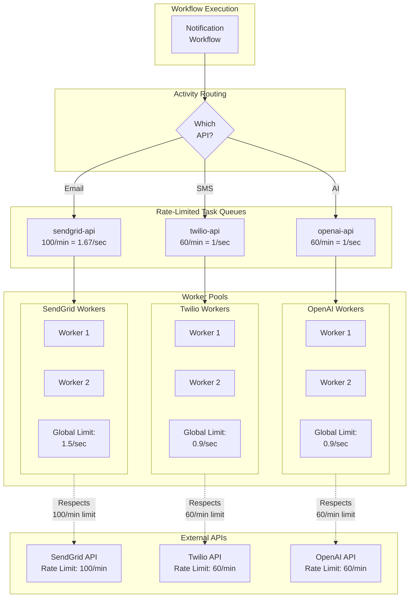

**by Cecil Phillip**

Third-party APIs such as SendGrid, Stripe, OpenAI, and Twilio let you add email, payments, AI, and messaging to an application without building them yourself, but each one enforces rate limits, and those limits vary by provider, service, and plan. Exceed them and you get HTTP 429 "Too Many Requests" errors, Activities that consume Worker resources on calls that were always going to fail, Workflows that can't make progress, and, after repeated violations, a temporary or permanent ban from the service. One Workflow's excessive calls can even affect others. Handling 429s with retries alone is reactive: by the time you retry, the limit has already been exceeded.

A more reliable approach is to keep the requests from exceeding the limit in the first place. Give each rate-limited API its own Task Queue, and configure the Workers that poll it with a queue-wide Activity rate limit. The Temporal Server enforces that limit across every Worker on the queue, so you can add Workers without sending the API more requests than it allows. Per-Worker and concurrency limits add finer control where an API needs it, and when an occasional 429 still gets through, your Activities wait as long as the API's `Retry-After` header asks.

With this guide, you'll build a notification system that calls SendGrid, OpenAI, and Stripe through rate-limited Task Queues, with:

- **Rate limit compliance:** Activities respect API rate limits, eliminating 429 errors and preventing account suspension
- **Improved reliability:** Workflows complete successfully without failures caused by rate limits
- **Resource efficiency:** Workers don't waste resources on doomed-to-fail Activities
- **Better API relationships:** Consistent rate limit compliance maintains good standing with API providers
- **Independent scaling:** Add more Workers without exceeding API rate limits, because the queue-wide limit still applies

## Background

The solution to rate limiting downstream APIs is to use a Task Queue routing pattern. Instead of letting every Worker call an external API as fast as it can, you route that API's Activities to a dedicated Task Queue, and the Temporal Server limits how quickly Activity Tasks from that queue are dispatched to Workers. For more about the pattern, including how the queue-wide limit compares with per-Worker and concurrency-slot alternatives, see [Downstream Rate Limiting](/design-patterns/downstream-rate-limiting).

In this guide, a notification Workflow sends email through SendGrid and generates text with OpenAI, and a third pool of Workers handles Stripe payments. Each API gets its own Task Queue and its own Workers, configured with a rate limit set just under what the API allows. The Workflow runs on a separate Task Queue of its own and sends each Activity to the queue for its API.

## Prerequisites

This guide requires Python, the Temporal Python SDK, a Temporal Server, and API keys for the external services you want to call.

### Required software and infrastructure

- Temporal Server v1.17+ (for `max_task_queue_activities_per_second` support)
- Python 3.8 or later
- Temporal Python SDK v1.0.0 or later (`pip install temporalio`)
- API keys and documentation for external services

### Resources and access privileges

- Temporal Namespace with permissions to start Workflows and register Workers
- API keys with known rate limits for external services
- Access to API provider dashboards to monitor usage

### Required concepts

You should be familiar with the following before proceeding:

- [Temporal Workflows](/workflows): The durable, stateful functions that Temporal orchestrates
- [Temporal Activities](/activities): The functions that perform side effects, such as calls to external APIs
- [Temporal Task Queues](/task-queue): The named queues that route work from the Temporal Server to Workers
- [Retry Policies](/encyclopedia/retry-policies): How Temporal retries failed Activities, including exponential backoff
- HTTP client libraries (httpx, requests)
- API authentication (API keys, OAuth)

### Operational considerations

Before implementing this pattern, keep the following in mind:

**Monitor API usage.** Track actual API calls against rate limits so you can adjust the limits configured on your Task Queues.

**API limit changes.** API providers may change their rate limits. Monitor them and update your Worker configuration to match.

**Burst allowance.** Some APIs allow short bursts above their stated limits. Test to determine safe Temporal limits.

**Multiple environments.** Use separate API keys and Task Queues for dev, staging, and prod.

## Step 1: Identify API rate limits

Every limit you configure later comes from this inventory, so start by documenting the rate limits of each external API your application uses. Limits vary by provider and plan. SendGrid, for example, allows 100 emails per minute on its free tier and 1,000 per minute on paid plans.

Here's an example inventory:

| API | Rate Limit | Concurrency Limit | Plan/Tier | Notes |
|-----|-----------|-------------------|-----------|-------|
| SendGrid | 100 req/min | None | Free | Burst: 300/min for 1 min |
| Stripe | 100 req/sec | None | Standard | Per API key globally |
| OpenAI | 60 req/min | None | Tier 1 | Also: 90K tokens/min |
| Twilio | 60 req/min | None | Free | Per phone number |
| Database | None | 100 connections | N/A | Connection pool limit |

To build your own:

1. Review the API documentation for each integrated service.
2. Check the limits for your current plan or tier.
3. Determine whether each limit applies per API key, per account, or per resource.
4. Set Temporal rate limits to 90% of the API limits, to leave a safety buffer.

With each limit written down, along with what it applies to, you have the numbers your Workers will enforce. Next, you'll give each API a Task Queue to enforce them on.

## Step 2: Define Task Queue constants

Each rate-limited API gets its own Task Queue, which isolates one API's limit from another's. The following diagram shows the goal: the Workflow routes each Activity to the queue for its API, and each queue's pool of Workers calls that API no faster than the queue's global limit.



Task Queues in Temporal are created dynamically the first time they're referenced, so you don't need to register them anywhere. You only need names that your Workers and your Workflow agree on.

Create a file named `task_queues.py` and define one constant per API:

```python
# task_queues.py
SENDGRID_API_QUEUE = "sendgrid-api"
STRIPE_API_QUEUE = "stripe-api"
OPENAI_API_QUEUE = "openai-api"
TWILIO_API_QUEUE = "twilio-api"
```

Each constant names the Task Queue for one rate-limited API. Keeping the names in a single module means the Workers that poll a queue and the Workflow that sends Activities to it always use the same string.

With a named queue for each API, you're ready to start the Workers that poll those queues and enforce each API's limit.

## Step 3: Configure Workers with rate limiting

Rate limiting is configured on the Worker, and the limit that matters most is enforced by the Temporal Server across every Worker on the queue. You'll create one Worker program per API. The Python SDK gives you three controls:

- **`max_task_queue_activities_per_second`** (global): Limits Activity dispatch across all Workers on the queue. The Temporal Server enforces it, which makes it the best fit for API rate limits. If Workers on the same queue set different values, the last value wins.
- **`max_activities_per_second`** (per-Worker): Limits the Activities a single Worker runs. You can combine it with the global limit for finer control.
- **`max_concurrent_activities`** (concurrency): Limits concurrent executions. Use it when an API or resource limits concurrent connections, such as a database connection pool.

Start with SendGrid. Create a file named `worker_sendgrid.py` and add the imports:

```python
# worker_sendgrid.py
import asyncio
import logging
from temporalio.client import Client
from temporalio.worker import Worker

from task_queues import SENDGRID_API_QUEUE
from activities import send_email, send_batch_email

logging.basicConfig(level=logging.INFO)
```

Along with the Temporal `Client` and `Worker` classes, you're importing the SendGrid queue name from Step 2 and the Activities this Worker will run. You'll write those Activities in Step 4.

Now add a `main` function that connects to Temporal, creates the Worker, and runs it:

```python
async def main():
    client = await Client.connect("localhost:7233")

    worker = Worker(
        client,
        task_queue=SENDGRID_API_QUEUE,
        activities=[send_email, send_batch_email],
        max_task_queue_activities_per_second=1.5,
        max_activities_per_second=0.5,
        max_concurrent_activities=20,
    )

    logging.info(
        f"Starting SendGrid worker on {SENDGRID_API_QUEUE} "
        f"(max 1.5/sec globally)"
    )
    await worker.run()

if __name__ == "__main__":
    asyncio.run(main())
```

The Worker polls the SendGrid queue and registers the SendGrid Activities. The three rate-limiting settings do the real work:

- `max_task_queue_activities_per_second=1.5`: SendGrid's free tier allows 100 emails per minute, about 1.67 per second. A limit of 1.5 per second leaves a safety buffer. This limit applies globally, across all Workers on this queue.
- `max_activities_per_second=0.5`: This optional per-Worker limit keeps any single Worker from bursting.
- `max_concurrent_activities=20`: This caps concurrent connections. SendGrid allows many concurrent connections, so the cap is generous.

:::caution
Eager Activity execution can bypass a Task Queue's rate limit. It applies only when an Activity is scheduled on the same Task Queue as its Workflow and the Worker running the Workflow has the Activity registered. The Temporal Service then returns the Activity Task directly to that Worker instead of dispatching it through the Task Queue. A Worker that sets `max_task_queue_activities_per_second` never requests eager execution, so set it on every Worker that polls a rate-limited queue.
:::

The OpenAI Worker follows the same structure. Create a file named `worker_openai.py`:

```python
# worker_openai.py
import asyncio
import logging
from temporalio.client import Client
from temporalio.worker import Worker

from task_queues import OPENAI_API_QUEUE
from activities import generate_text, generate_embeddings

logging.basicConfig(level=logging.INFO)

async def main():
    client = await Client.connect("localhost:7233")

    worker = Worker(
        client,
        task_queue=OPENAI_API_QUEUE,
        activities=[generate_text, generate_embeddings],
        max_task_queue_activities_per_second=0.9,
        max_concurrent_activities=5,
    )

    logging.info(
        f"Starting OpenAI worker on {OPENAI_API_QUEUE} "
        f"(max 0.9/sec globally)"
    )
    await worker.run()

if __name__ == "__main__":
    asyncio.run(main())
```

OpenAI's Tier 1 limit is 60 requests per minute, or 1 per second, so this Worker sets the global limit to 0.9 per second for safety. It also limits concurrent requests to 5.

Finally, create a file named `worker_stripe.py`:

```python
# worker_stripe.py
import asyncio
import logging
from temporalio.client import Client
from temporalio.worker import Worker

from task_queues import STRIPE_API_QUEUE
from activities import create_payment, refund_payment

logging.basicConfig(level=logging.INFO)

async def main():
    client = await Client.connect("localhost:7233")

    worker = Worker(
        client,
        task_queue=STRIPE_API_QUEUE,
        activities=[create_payment, refund_payment],
        max_task_queue_activities_per_second=90,
        max_concurrent_activities=50,
    )

    logging.info(
        f"Starting Stripe worker on {STRIPE_API_QUEUE} "
        f"(max 90/sec globally)"
    )
    await worker.run()

if __name__ == "__main__":
    asyncio.run(main())
```

Stripe allows 100 requests per second globally, so this Worker sets the global limit to 90 per second for safety. Stripe allows high concurrency, so up to 50 Activities can run at once.

When you deploy these Workers, keep the following in mind:

- Deploy 2–5 Workers per API-specific Task Queue.
- The Temporal Service enforces the rate limit globally, across all Workers on the queue.
- More Workers give you better fault tolerance, but the rate limit still applies.
- Monitor Worker CPU and memory. Rate-limited Workers typically have low utilization.

Your Workers are now configured to take Activity Tasks no faster than each API allows. They can't start yet, though, because the Activities they register don't exist. You'll write those next.

## Step 4: Implement Activities and error handling

Each Activity makes one call to an external API. The Task Queue limits from Step 3 keep those calls within bounds, so the Activities don't need any rate-limiting logic of their own. They do need to handle the occasional 429 that gets through anyway.

Create a file named `activities.py` and add the imports and API keys:

```python
# activities.py
import httpx
from temporalio import activity
from temporalio.exceptions import ApplicationError
from datetime import timedelta

SENDGRID_API_KEY = "your-sendgrid-key"
STRIPE_API_KEY = "your-stripe-key"
OPENAI_API_KEY = "your-openai-key"
```

The Activities use `httpx` for asynchronous HTTP calls and `ApplicationError` to tell Temporal when to retry. The API keys are placeholders; in production, read them from environment variables instead.

Next, add the `send_email` Activity. Start with the request to SendGrid:

```python
@activity.defn
async def send_email(email_data: dict) -> dict:
    activity.logger.info(f"Sending email to {email_data['to']}")

    async with httpx.AsyncClient() as client:
        try:
            response = await client.post(
                "https://api.sendgrid.com/v3/mail/send",
                headers={
                    "Authorization": f"Bearer {SENDGRID_API_KEY}",
                    "Content-Type": "application/json",
                },
                json={
                    "personalizations": [{"to": [{"email": email_data["to"]}]}],
                    "from": {"email": "noreply@example.com"},
                    "subject": email_data["subject"],
                    "content": [{"type": "text/html", "value": email_data["body"]}],
                },
                timeout=30.0,
            )

            response.raise_for_status()
            activity.logger.info(f"Email sent to {email_data['to']}")

            return {"status": "sent", "email": email_data["to"]}
```

`send_email` posts the message to SendGrid's mail-send endpoint and returns a status on success. Notice that it doesn't throttle itself: the SendGrid Worker already limits it to 1.5 executions per second globally. `raise_for_status()` turns any error response into an exception, which you'll handle next.

Even with rate limiting, occasional 429 errors can occur. Another system might be using the same API key, the provider might reduce its limits temporarily, or traffic might arrive in a burst. When that happens, check the response for a `Retry-After` header. If it's present, raise an `ApplicationError` with `next_retry_delay` set to the header's value, so Temporal retries when the API says to. If it's not present, re-raise the exception so the Activity's Retry Policy falls back to exponential backoff.

Still inside `send_email`, add the error handling:

```python
        except httpx.HTTPStatusError as e:
            if e.response.status_code == 429:
                retry_after = e.response.headers.get("Retry-After")

                if retry_after:
                    retry_delay = timedelta(seconds=int(retry_after))
                    activity.logger.warning(
                        f"Rate limit hit for {email_data['to']}, "
                        f"retry after {retry_after}s"
                    )
                    raise ApplicationError(
                        "Rate limit exceeded",
                        non_retryable=False,
                        next_retry_delay=retry_delay,
                    )
                else:
                    activity.logger.warning(
                        f"Rate limit hit for {email_data['to']}, "
                        f"using exponential backoff"
                    )
                    raise

            activity.logger.error(f"HTTP error {e.response.status_code}: {e}")
            raise

        except Exception as e:
            activity.logger.error(f"Failed to send email: {e}")
            raise
```

The `Retry-After` value is a number of seconds, so it converts directly to a `timedelta`. Setting `non_retryable=False` keeps the error retryable; `next_retry_delay` only overrides how long Temporal waits before the next attempt. Any other HTTP error is logged and re-raised, as is any other exception, so Temporal's normal retry behavior applies to those.

The OpenAI Activity follows the same pattern. Add `generate_text`:

```python
@activity.defn
async def generate_text(prompt: str) -> dict:
    activity.logger.info(f"Generating text for prompt: {prompt[:50]}...")

    async with httpx.AsyncClient() as client:
        try:
            response = await client.post(
                "https://api.openai.com/v1/chat/completions",
                headers={
                    "Authorization": f"Bearer {OPENAI_API_KEY}",
                    "Content-Type": "application/json",
                },
                json={
                    "model": "gpt-3.5-turbo",
                    "messages": [{"role": "user", "content": prompt}],
                },
                timeout=60.0,
            )

            response.raise_for_status()
            result = response.json()

            activity.logger.info("Text generated successfully")
            return {
                "text": result["choices"][0]["message"]["content"],
                "usage": result["usage"],
            }

        except httpx.HTTPStatusError as e:
            if e.response.status_code == 429:
                retry_after = e.response.headers.get("Retry-After")
                error_data = e.response.json()

                if retry_after:
                    retry_delay = timedelta(seconds=int(retry_after))
                    activity.logger.warning(
                        f"OpenAI rate limit, retry after {retry_after}s: "
                        f"{error_data.get('error', {}).get('message')}"
                    )
                    raise ApplicationError(
                        "OpenAI rate limit exceeded",
                        non_retryable=False,
                        next_retry_delay=retry_delay,
                    )
                else:
                    activity.logger.warning(
                        f"OpenAI rate limit, using exponential backoff: "
                        f"{error_data.get('error', {}).get('message')}"
                    )
                    raise

            activity.logger.error(f"OpenAI error {e.response.status_code}: {e}")
            raise
```

`generate_text` sends the prompt to OpenAI's chat completions endpoint, with a longer timeout than the email call, and returns the generated text along with token usage. The 429 handling matches `send_email`, except that it also reads the error message from the response body and includes it in the log. The SendGrid Worker's global limit doesn't apply here; the OpenAI Worker limits this Activity to 0.9 executions per second.

Finally, add `create_payment` for Stripe:

```python
@activity.defn
async def create_payment(payment_data: dict) -> dict:
    activity.logger.info(
        f"Creating payment for ${payment_data['amount']/100:.2f}"
    )

    async with httpx.AsyncClient() as client:
        try:
            response = await client.post(
                "https://api.stripe.com/v1/payment_intents",
                headers={
                    "Authorization": f"Bearer {STRIPE_API_KEY}",
                },
                data={
                    "amount": payment_data["amount"],
                    "currency": payment_data["currency"],
                    "payment_method": payment_data["payment_method"],
                    "confirm": "true",
                },
                timeout=30.0,
            )

            response.raise_for_status()
            result = response.json()

            activity.logger.info(f"Payment created: {result['id']}")
            return {
                "payment_id": result["id"],
                "status": result["status"],
            }

        except httpx.HTTPStatusError as e:
            if e.response.status_code == 429:
                retry_after = e.response.headers.get("Retry-After")

                if retry_after:
                    retry_delay = timedelta(seconds=int(retry_after))
                    activity.logger.warning(
                        f"Stripe rate limit hit, retry after {retry_after}s"
                    )
                    raise ApplicationError(
                        "Stripe rate limit exceeded",
                        non_retryable=False,
                        next_retry_delay=retry_delay,
                    )
                else:
                    activity.logger.warning(
                        "Stripe rate limit hit, using exponential backoff"
                    )
                    raise

            activity.logger.error(f"Stripe error {e.response.status_code}")
            raise
```

`create_payment` creates and confirms a Stripe payment intent. Unlike the other two calls, it sends form-encoded `data` rather than JSON. The Stripe Worker limits it to 90 executions per second, and its 429 handling follows the same pattern as the other Activities.

Your Activities now make their API calls and respond sensibly when a provider pushes back. The remaining piece is a Workflow that sends each Activity to the right queue.

## Step 5: Route Activities to rate-limited queues in Workflows

An Activity doesn't choose its own Task Queue; the Workflow chooses one each time it schedules the Activity. In this step, you'll write a notification Workflow that sends email work to the SendGrid queue and AI work to the OpenAI queue, then a starter that runs 100 notifications at once.

Create a file named `notification_workflow.py` and add the imports:

```python
# notification_workflow.py
from datetime import timedelta
from dataclasses import dataclass
from temporalio import workflow
from temporalio.common import RetryPolicy

with workflow.unsafe.imports_passed_through():
    from task_queues import SENDGRID_API_QUEUE, OPENAI_API_QUEUE, STRIPE_API_QUEUE
```

The queue constants are imported inside `workflow.unsafe.imports_passed_through()`, which lets the Workflow sandbox use the `task_queues` module as is instead of re-importing it for each Workflow run.

Define the Workflow's input:

```python
@dataclass
class NotificationRequest:
    user_email: str
    notification_type: str
    data: dict
```

`notification_type` determines which APIs the Workflow calls, and `data` carries the content of the notification.

Now define the Workflow class and start its `run` method:

```python
@workflow.defn
class NotificationWorkflow:
    @workflow.run
    async def run(self, request: NotificationRequest) -> dict:
        workflow.logger.info(
            f"Processing {request.notification_type} notification "
            f"for {request.user_email}"
        )

        results = {}
```

`NotificationWorkflow` sends a notification through one or more rate-limited APIs, routing each Activity to the right queue based on the notification type. `results` collects the output of each Activity it runs.

Inside `run`, add the email branch:

```python
        if "email" in request.notification_type:
            email_result = await workflow.execute_activity(
                "send_email",
                {
                    "to": request.user_email,
                    "subject": f"{request.notification_type} Notification",
                    "body": str(request.data),
                },
                task_queue=SENDGRID_API_QUEUE,
                start_to_close_timeout=timedelta(minutes=2),
                retry_policy=RetryPolicy(
                    initial_interval=timedelta(seconds=1),
                    maximum_interval=timedelta(minutes=10),
                    backoff_coefficient=2.0,
                    maximum_attempts=5,
                ),
            )
            results["email"] = email_result
```

When the notification type includes `email`, the Workflow schedules `send_email` by name and sets `task_queue=SENDGRID_API_QUEUE`, so the Activity is dispatched at no more than the SendGrid queue's 1.5 per second. Because the API queues are separate from the Workflow's own Task Queue, these Activities never run eagerly.

The Retry Policy is what takes over when an Activity re-raises a 429 without a `Retry-After` header. With this configuration, the retry intervals follow this pattern:

- Attempt 1: 1 second
- Attempt 2: 2 seconds (1s × 2.0)
- Attempt 3: 4 seconds (2s × 2.0)
- Attempt 4: 8 seconds (4s × 2.0)
- Attempt 5: 16 seconds (8s × 2.0)

Total time before failure: ~31 seconds across 5 attempts.

Two settings differ from the default Retry Policy:

- **`maximum_attempts`** is set to `5` instead of the default, unlimited. This prevents infinite retries for persistent rate-limiting issues and ensures timely failure detection. Activities won't retry indefinitely if an API is experiencing extended downtime or if your rate limits have been permanently reduced.
- **`maximum_interval`** is set to 10 minutes instead of the default, 100 times `initial_interval`. This caps retry delays at a reasonable duration.

Together with the `Retry-After` handling in your Activities, this respects each API's rate-limit guidance while providing a sensible fallback.

Still inside `run`, add the AI branch and return the results:

```python
        if "ai" in request.notification_type:
            ai_result = await workflow.execute_activity(
                "generate_text",
                f"Generate notification: {request.data}",
                task_queue=OPENAI_API_QUEUE,
                start_to_close_timeout=timedelta(minutes=5),
                retry_policy=RetryPolicy(
                    initial_interval=timedelta(seconds=1),
                    maximum_interval=timedelta(minutes=10),
                    backoff_coefficient=2.0,
                    maximum_attempts=5,
                ),
            )
            results["ai"] = ai_result

        workflow.logger.info(f"Notification sent to {request.user_email}")
        return results
```

When the type includes `ai`, the Workflow schedules `generate_text` on the OpenAI queue, which limits it to 0.9 per second. It allows a longer Start-To-Close Timeout of 5 minutes for text generation and uses the same Retry Policy.

To see the rate limits at work, create a file named `start_workflow.py`:

```python
# start_workflow.py
import asyncio
from temporalio.client import Client
from notification_workflow import NotificationWorkflow, NotificationRequest

async def main():
    client = await Client.connect("localhost:7233")

    for i in range(100):
        request = NotificationRequest(
            user_email=f"user{i}@example.com",
            notification_type="email",
            data={"message": f"Notification {i}"},
        )

        handle = await client.start_workflow(
            NotificationWorkflow.run,
            request,
            id=f"notification-{i}",
            task_queue="workflows",
        )

        print(f"Started workflow {i}: {handle.id}")

    print("All workflows started. Rate limiting ensures API compliance.")

if __name__ == "__main__":
    asyncio.run(main())
```

The starter launches 100 email notifications as fast as it can. The Workflows all start right away on the `workflows` Task Queue, but their `send_email` Activities are dispatched no faster than the SendGrid queue allows, so rate limiting prevents API overload.

:::note
TODO: Link to the complete, commented source for this guide.
:::

You now have the full pipeline: a queue per API, Workers that enforce each API's limit, Activities that honor `Retry-After`, and a Workflow that routes work to the right place. Next, you'll prepare for the times when a downstream API throttles you anyway.

## Step 6: Drain backlogs and adjust limits

Rate limits protect the APIs, but they also mean that work waits its turn. During throttling events, Task Queues can grow significantly, and operators need to switch to draining mitigation mode when backlogs occur.

### Plan for draining

Before a backlog forms, decide on these points:

- **Acceptable SLA/SLO for draining:** How long is acceptable for the queue to drain? Hours? Days?
- **Cascading failures:** Simply increasing downstream API or Temporal Cloud rate limits may move the bottleneck elsewhere, potentially overwhelming the next component in line.

When a backlog does form, consider these mitigation strategies in order:

1. **Request downstream API rate limit increases:** Work with API providers to increase your rate limits.
2. **Request Temporal Cloud rate limit increases:** If you use Temporal Cloud, request higher limits.
3. **Scale Worker pools:** Add more Workers or adjust Worker configuration.
4. **Increase internal resources:** Scale your infrastructure.
5. **Identify the next bottleneck:** Determine what will be throttled next, to prevent cascading failures.

### Adjust limits and reset Activities from the CLI

Operators can change a Task Queue's rate limit without redeploying Workers. To set the limit for the SendGrid queue:

```bash
temporal task-queue config set --queue-rps-limit 99 --task-queue sendgrid-api
```

When a downstream API recovers from an outage, some Activities may still be waiting at their maximum retry interval, which is 10 minutes with the Retry Policy in this guide. To reset an Activity so it retries immediately:

```bash
temporal activity reset --workflow-id <workflow-id> --activity-id <activity-id>
```

With these tools, operators can work through a backlog without redeploying anything, while the rate-limited queues keep protecting the APIs downstream.

## Outcomes

You've built a notification system that stays within the rate limits of every API it calls. Each API has its own Task Queue, the Temporal Server enforces a queue-wide dispatch rate across all of that queue's Workers, per-Worker and concurrency limits add finer control, and Activities wait for the API's `Retry-After` interval when a 429 slips through. Because the limit belongs to the queue rather than to any one Worker, you can scale Workers for fault tolerance without putting your standing with an API provider at risk. The same approach works for any shared resource with a fixed capacity: database connection pools, internal services with quotas, SMS gateways, or LLM providers with token budgets.

## Related resources

### Related patterns

- [Downstream Rate Limiting](/design-patterns/downstream-rate-limiting) - Pattern catalog reference for this technique, covering `MaxTaskQueueActivitiesPerSecond` versus per-worker and concurrency-slot alternatives
- [Separate Task Queues - Worker Affinity](worker-execution-affinity) - For activities on same Worker

### Official documentation

- [Temporal Documentation - Task Routing](/task-routing)
- [Temporal Best Practices - Separate Task Queues](/best-practices/worker#separate-task-queues-logically)
- [Python SDK Worker Configuration](https://python.temporal.io/temporalio.worker.Worker.html)

### Community resources

- [Forum: When to Use Multiple Task Queues](https://community.temporal.io/t/in-what-situation-should-we-use-multiple-separated-task-queues/1254)
- [Slack: Rate Limiting Activities](https://temporal.io/slack) - Search for "rate limiting" discussions

### API documentation

- [SendGrid Rate Limits](https://docs.sendgrid.com/api-reference/rate-limits)
- [Stripe Rate Limits](https://docs.stripe.com/rate-limits)
- [OpenAI Rate Limits](https://platform.openai.com/docs/guides/rate-limits)
