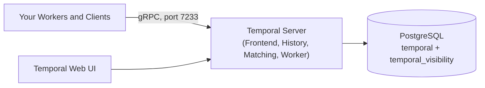

A small self-hosted Temporal Service runs three things: one Temporal Server process, one PostgreSQL database, and the
Temporal Web UI. The Temporal Server runs its Frontend, History, Matching, and Worker services together in that one
process. PostgreSQL stores both Workflow state and [Visibility](/visibility) data, so you don't need Elasticsearch,
OpenSearch, or Cassandra. This setup has no high availability for the server: if the server process stops, Workflows
pause until it restarts.

Use this setup for a small team with a modest, predictable workload that can accept brief planned downtime during
upgrades. If you need the service to stay available through a host failure, sustained high throughput, or an uptime SLA,
see [When to move to a larger deployment](#grow).

Your Workers run in your own application whichever way you host the Temporal Service. This page covers only the
Temporal Service.

:::caution Not SQLite, not the development server

SQLite and `temporal server start-dev` are for development and testing only, including with `--db-filename`. Use
PostgreSQL or MySQL for any Temporal Service that holds Workflows you need to keep.

:::

## What you run {/* #components */}

| Component       | What to use                                                                                                                          | Notes                                                                                                         |
| --------------- | ------------------------------------------------------------------------------------------------------------------------------------ | ------------------------------------------------------------------------------------------------------------- |
| Temporal Server | One `temporalio/server` container, or the `temporal-server` binary                                                                   | Runs all four services in one process by default.                                                             |
| Database        | PostgreSQL 12 or later. A managed service such as Amazon RDS, Google Cloud SQL, or Azure Database for PostgreSQL keeps backups and patching off your plate. | Holds two databases: `temporal` for Workflow state and `temporal_visibility` for Visibility. MySQL 8.0.17 or later also works. |
| Web UI          | One `temporalio/ui` container                                                                                                        | Lets you browse and act on Workflow Executions.                                                               |
| Schema tool     | The `temporalio/admin-tools` image, run as a one-off job                                                                             | Creates and upgrades the database schemas. It doesn't run continuously.                                       |



## Set up the service {/* #set-up */}

1. **Create the database.** Provision PostgreSQL on a private network that the server host can reach.

2. **Choose the History Shard count before the first start.**

   :::warning Set `numHistoryShards` to 512

   The number of [History Shards](/temporal-service/temporal-server#history-shard) is fixed when the Temporal Service
   first starts. You can't change it later without building a new Temporal Service and moving your Workflows to it.

   The `temporalio/server` image reads the value from the `NUM_HISTORY_SHARDS` environment variable and defaults to
   `4`, which is meant for development. Set `NUM_HISTORY_SHARDS=512` before the first start.

   :::

3. **Create the schemas.** Run `temporal-sql-tool` from the `temporalio/admin-tools` image to create the `temporal`
   and `temporal_visibility` databases and their schemas. Use the image version that matches your server version. See
   [Database schema and setup](/self-hosted-guide/visibility/postgresql#database-schema-and-setup) for the commands.

4. **Start the server and the Web UI.** Start from
   [`docker-compose-postgres.yml`](https://github.com/temporalio/samples-server/blob/main/compose/docker-compose-postgres.yml)
   in the samples-server repository. It runs one `temporal` container with all four services, PostgreSQL for both
   persistence and Visibility, and the Web UI. To use your own database, remove the bundled `postgresql` service, point
   `POSTGRES_SEEDS`, `POSTGRES_USER`, and `POSTGRES_PWD` at your database, and add `NUM_HISTORY_SHARDS=512` to the
   `temporal` service. Pin the image tags to a specific version.

5. **Create a Namespace with a Retention Period.** The Retention Period controls how long closed Workflow Executions
   stay in the database.

   ```bash
   temporal operator namespace create --namespace your-namespace --retention 7d
   ```

6. **Keep the server off the public internet.** Expose port 7233 only to your Workers and Clients on a private network.
   To authenticate them, configure [mTLS](/self-hosted-guide/security#encryption-in-transit-with-mtls).

## Operate the service {/* #operate */}

- **Backups.** All Temporal state lives in PostgreSQL. Use your database's automated backups and point-in-time
  recovery. The server process holds no state that needs a backup.
- **Database growth.** Closed Workflow Executions stay in the database until the Namespace
  [Retention Period](/temporal-service/temporal-server#retention-period) passes. Choose a Retention Period that matches
  how long you need to inspect closed Workflows. To keep Event Histories longer, set up
  [Archival](/self-hosted-guide/archival). On busy deployments, also plan for
  [Visibility index maintenance](/self-hosted-guide/visibility/postgresql#postgresql-index-maintenance).
- **Monitoring.** Set `PROMETHEUS_ENDPOINT` on the server container (for example, `0.0.0.0:8000`) and scrape it. At a
  minimum, alert when the server process restarts or stops, when `persistence_latency` or `service_errors` rise, and
  when database CPU or storage runs high. See [Monitoring](/self-hosted-guide/monitoring).

## Upgrade the server {/* #upgrade */}

Upgrade one minor version at a time, and update the schemas before the server:

1. Read the [release notes](https://github.com/temporalio/temporal/releases) for the next minor version.
2. Upgrade to the latest patch release of your current minor version.
3. Update the `temporal` and `temporal_visibility` schemas with `temporal-sql-tool update-schema`, using the
   `temporalio/admin-tools` image for the target version.
4. Change the server image tag to the target version and restart the server.
5. Repeat for each minor version until you reach the version you want.

**Don't skip minor versions, and don't deploy the `latest` tag.** Temporal Server guarantees data compatibility only
between consecutive minor versions.

With one server instance, the restart in step 4 is a short outage. Workflows pause and continue when the server is back.
See [Upgrade the Temporal Server](/self-hosted-guide/upgrade-server#upgrade-server) for timing and the full procedure.

## What this setup doesn't provide {/* #limits */}

- **Server high availability.** The server process is a single point of failure. While it's down, Workers can't poll
  for Tasks, Timers don't fire, and Clients can't start Workflows or send Signals. No Workflow state is lost, because it
  lives in PostgreSQL, and Workflows continue when the server restarts. Database availability depends on how you run
  PostgreSQL.
- **Zero-downtime upgrades.** Each upgrade restarts the only server instance.
- **More instances by adding replicas.** Running more than one server instance requires each instance to join the
  cluster membership with a reachable address. Start from the [Helm charts](https://github.com/temporalio/helm-charts)
  or the multi-role
  [Docker Compose example](https://github.com/temporalio/samples-server/blob/main/compose/docker-compose-multirole.yaml)
  instead of adding replicas of the single container.
- **Paid support.** Temporal doesn't offer paid support for self-hosted deployments. Community support is available
  on the [Temporal community forum](https://community.temporal.io) and [Temporal Slack](https://temporal.io/slack).

## When to move to a larger deployment {/* #grow */}

Plan a larger deployment when you see any of these signals:

- `persistence_latency` or database CPU stays high under normal load.
- Listing and filtering Workflow Executions in the Web UI or CLI becomes slow.
- The service needs to stay available through a server restart or a host failure.
- Your workload is growing toward sustained high throughput.

Next steps, which you can take one at a time:

- Run the services as separate processes so you can scale each one. See [Deployment](/self-hosted-guide/deployment).
- Move Visibility to [Elasticsearch or OpenSearch](/self-hosted-guide/visibility/elasticsearch), using
  [Dual Visibility](/dual-visibility) to migrate.
- Work through the [production checklist](/self-hosted-guide/production-checklist).

Setting 512 History Shards at the start leaves room to scale the same Temporal Service. If you'd rather not run the
Temporal Service yourself, [Temporal Cloud](/cloud) runs it for you, and your Workers stay on your infrastructure.
