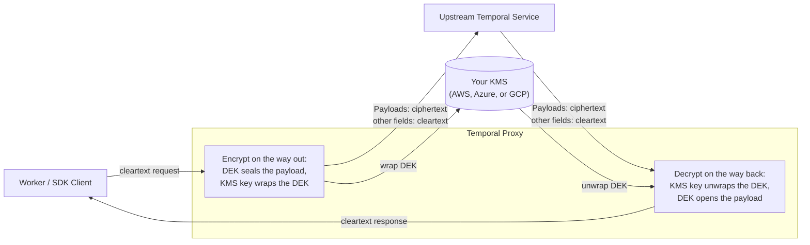

import { ReleaseNoteHeader } from '@site/src/components';

<ReleaseNoteHeader type="prerelease">
  Temporal Proxy is under active development and evolving quickly. Behavior and configuration can change between
  releases. See the [temporal-proxy repository](https://github.com/temporalio/temporal-proxy) for the current status
  and the definitive configuration schema.
</ReleaseNoteHeader>

The proxy can encrypt Workflow and Activity payloads on the hop to an upstream and decrypt them on responses, set under
the top-level `encryption` block. It is off by default. Workers and Clients keep exchanging cleartext with the gateway;
the proxy seals codec-capable Payloads before they leave and opens them on the way back. New Payloads sent through the
proxy reach the upstream Temporal Service as ciphertext. Encryption is transparent, requiring no change to Worker or
Client code.

It uses envelope encryption: a short-lived data encryption key (DEK) encrypts each payload with AES-256-GCM, and a KMS
key you own wraps the DEK. The wrapped DEK and a reference to the key that wrapped it travel with the payload, so the
proxy never holds key material; it calls your KMS to wrap and unwrap DEKs. Supported key schemes are `awskms`,
`azurekeyvault`, and `gcpkms` for cloud KMS, `extension` for a
[key management backend you run yourself](#plug-in-your-own-key-management-backend), and `testing` for local development
only.



**Configuration**

```yaml
encryption:
  enabled: true # Encrypt new payloads. Optional; defaults to false.
  namespaceBinding: strict # Required with keys: off, permissive, or strict.
  failures: true # Also encrypt failure messages and stack traces. Requires enabled.
  cacheSize: 100 # Bounds the in-memory decrypted-DEK cache. Omit for 100; 0 disables it.
  default: # Fallback key policy for any Namespace without an override.
    uri: awskms:///arn:aws:kms:us-east-1:123456789012:key/abcd-1234?region=us-east-1
    duration: 1h # How long a DEK is used for new encryption before it rotates.
    renewBefore: 15m # Lead time before expiry to pre-rotate. Must be less than duration.
  overrides: # Per-Namespace policies, keyed by local (pre-translation) Namespace.
    payments:
      uri: gcpkms://projects/my-project/locations/global/keyRings/codec/cryptoKeys/v1
      duration: 30m
      renewBefore: 5m
```

- `default` is a key policy required whenever `enabled: true`. It makes encryption fail-closed: any Namespace without
  its own override, including Namespaces created after startup, uses the default rather than sending plaintext. Enabling
  encryption without a `default` is a startup error.
- `overrides` maps a local Namespace to its own key policy, which takes precedence over `default`. The keys are the
  local (pre-translation) Namespace names. Reach for overrides to scope blast radius, spread load across KMS keys, or
  keep a tenant's key in its own region or provider.
- `cacheSize` bounds the in-memory cache of decrypted DEKs, which avoids a KMS call on every message. Omit it for the
  default of 100; `0` disables the cache, so every decryption unwraps its DEK through the KMS. Before v0.6.0 an absent
  `cacheSize` disabled the cache, so upgrading a configuration that never set one turns the cache on.
- `namespaceBinding` ties each payload to the Namespace it was sealed in. It has no default: the proxy refuses to start
  with keys configured and no value set. Use `strict` for a new deployment. See
  [Bind payloads to their Namespace](#namespace-binding) before you set it on an existing one.
- `failures` encrypts the message and stack trace of outbound failures. See [Encrypt failures](#encrypt-failures).
- `skipEncodings` forwards payloads under the listed encodings without sealing them. See
  [Pass through payloads that are already encrypted](#skip-encodings).

:::note Scope of fail-closed behavior

Fail-closed applies to outbound codec-capable Payloads on calls that pass through a proxy where `encryption.enabled` is
`true`. If the proxy cannot encrypt one of these Payloads, such as when the KMS is unavailable, it fails the request
before sending it upstream. It does not fall back to plaintext.

The proxy cannot enforce encryption for a Client, Worker, Web UI, or CLI that connects directly to the upstream Temporal
Service. Restrict credentials and network paths when all application traffic must pass through the proxy.

On responses, the proxy decrypts Payloads that carry its encryption metadata. It passes other Payloads through unchanged
so data written before proxy adoption remains readable during a migration. This behavior continues until existing
plaintext data ages out under the Namespace's retention period.

Fail-closed does not mean that every request field is encrypted. Search Attributes remain unencrypted so the Temporal
Service can index them. Failure messages and stack traces are plain strings rather than Payloads, so they stay
unencrypted unless you set [`failures`](#encrypt-failures). Payloads under an encoding listed in
[`skipEncodings`](#skip-encodings) pass through as they arrive. See
[Codecs and Encryption](/production-deployment/data-encryption) for encryption coverage and
[Failure Converter](/failure-converter) for failure encoding.

:::

`default` and each `overrides` entry are key policies with the same shape:

| Field         | Meaning                                                                                                                                                                                                   |
| ------------- | --------------------------------------------------------------------------------------------------------------------------------------------------------------------------------------------------------- |
| `uri`         | Active key that wraps new DEKs. Required. Scheme must be `awskms`, `azurekeyvault`, `gcpkms`, `extension`, or `testing`. Each policy's `uri` must be unique across `default` and every `overrides` entry. |
| `decryptURIs` | Additional KMS keys accepted only when unwrapping existing DEKs, for key migration. Optional.                                                                                                             |
| `duration`    | How long a DEK is used for new encryption before it rotates. Must be greater than zero.                                                                                                                   |
| `renewBefore` | Lead time before expiry at which the proxy pre-rotates the DEK. Must be at least zero and less than `duration`.                                                                                           |

DEK rotation is automatic on the `duration` and `renewBefore` schedule; you do not manage it. Older payloads stay
decryptable because their wrapped DEK and key reference travel with them.

To change the active key without losing access to existing data, for example when switching providers, promote the new
key to `uri` and move the old one to `decryptURIs` in the same update. New payloads use the new key; older payloads
still resolve against the decrypt-only entry:

```yaml
encryption:
  default:
    uri: gcpkms://projects/my-project/locations/global/keyRings/codec/cryptoKeys/v2
    decryptURIs:
      - gcpkms://projects/my-project/locations/global/keyRings/codec/cryptoKeys/v1
```

:::note Multi-region deployments need a multi-region key

To stay available alongside a highly available upstream that fails over across regions, such as a Temporal Cloud High
Availability Namespace whose endpoint moves between regions, you typically run the proxy in more than one region. After
a failover, a payload sealed by the proxy in one region may be opened by the proxy in another, so every regional proxy
must be able to unwrap the others' DEKs. Back the key with a multi-region KMS key so the same key material is reachable
from every region. How you express that differs by provider:

- **AWS:** use a multi-Region key (its ID starts with `mrk-`) and replicate it into each region. The replicas share key
  material but each has its own regional ARN, so set each proxy's `uri` to its local ARN and list the other regions'
  ARNs in `decryptURIs`:

  ```yaml
  encryption:
    default:
      # Config for the us-east-1 proxy.
      uri: awskms:///arn:aws:kms:us-east-1:123456789012:key/mrk-abcd1234?region=us-east-1
      decryptURIs:
        - awskms:///arn:aws:kms:us-west-2:123456789012:key/mrk-abcd1234?region=us-west-2
  ```

- **Azure:** Key Vault keys are regional. Use a separate vault per region (or geo-replication), and, because each vault
  gives the key a distinct URI, set each proxy's `uri` to its local vault and list the other vaults' keys in
  `decryptURIs`.
- **GCP:** create the key in a multi-region location (for example, `locations/us`) or in `global`. The resource name is
  the same everywhere, so every proxy uses the identical `uri` and no `decryptURIs` are needed:
  `gcpkms://projects/my-project/locations/us/keyRings/codec/cryptoKeys/my-key`.

For a single-region proxy deployment, a regional key is the right choice; reach for a multi-region key only when the
proxy itself spans regions.

:::

Decryption always runs on any payload that references a known key, regardless of `enabled`. Setting `enabled: false`
stops new encryption but keeps opening older payloads, which is a valid decrypt-only posture. The proxy reads encryption
configuration at startup, so restart it after changing keys or policies.

The `testing://` scheme holds its key material in the configuration itself and provides no real security. Use it only
for local development, and point production at `awskms`, `azurekeyvault`, `gcpkms`, or an extension server.

The proxy authenticates to each cloud provider through that provider's default credential chain, so no key material or
static cloud credentials live in the proxy configuration. On Kubernetes, bind the proxy's service account to a cloud
identity (IRSA or Pod Identity on AWS, Workload Identity on Azure and GCP); off Kubernetes, the SDKs resolve credentials
from the host. Grant that identity only the permission to encrypt and decrypt with the specific key, as shown for each
provider below.

## AWS KMS {/* #aws-kms */}

Wrap DEKs with an AWS KMS symmetric key, referenced by ARN. The `awskms://` scheme uses a triple slash (`awskms:///`) so
the ARN can sit in the URL path; add `?region=` when the key's region differs from the proxy's ambient region. See the
[AWS KMS documentation](https://docs.aws.amazon.com/kms/latest/developerguide/overview.html).

The proxy needs `kms:Encrypt` and `kms:Decrypt` on the key. Attach them as an inline policy to the IAM role the proxy
runs as:

```bash
aws iam put-role-policy \
  --role-name temporal-proxy \
  --policy-name temporal-proxy-kms \
  --policy-document '{
    "Version": "2012-10-17",
    "Statement": [
      {
        "Effect": "Allow",
        "Action": ["kms:Encrypt", "kms:Decrypt"],
        "Resource": "arn:aws:kms:us-east-1:123456789012:key/abcd-1234"
      }
    ]
  }'
```

```yaml
encryption:
  enabled: true
  namespaceBinding: strict
  default:
    uri: awskms:///arn:aws:kms:us-east-1:123456789012:key/abcd-1234?region=us-east-1
    duration: 1h
    renewBefore: 15m
```

## Azure Key Vault

Wrap DEKs with a Key Vault key. The default algorithm is RSA-OAEP-256, so the key must be an RSA key; append
`?algorithm=` to the URI to override it. The key version is optional and defaults to the latest version. See the
[Azure Key Vault documentation](https://learn.microsoft.com/en-us/azure/key-vault/general/overview).

The proxy needs the `encrypt` and `decrypt` key operations, granted by the built-in Key Vault Crypto User role (Azure
RBAC) or an access policy that allows the Encrypt and Decrypt key permissions:

```bash
az role assignment create \
  --assignee <proxy-identity> \
  --role "Key Vault Crypto User" \
  --scope <key-vault-resource-id>
```

```yaml
encryption:
  enabled: true
  namespaceBinding: strict
  default:
    uri: azurekeyvault://my-vault.vault.azure.net/keys/my-key
    duration: 1h
    renewBefore: 15m
```

## Google Cloud KMS

Wrap DEKs with a Cloud KMS key, referenced by its full resource name. See the
[Cloud KMS documentation](https://cloud.google.com/kms/docs).

The proxy needs `cloudkms.cryptoKeyVersions.useToEncrypt` and `cloudkms.cryptoKeyVersions.useToDecrypt`, granted by the
`roles/cloudkms.cryptoKeyEncrypterDecrypter` role on the key and bound to the proxy's service account:

```bash
gcloud kms keys add-iam-policy-binding my-key \
  --location global --keyring codec \
  --member serviceAccount:proxy@my-project.iam.gserviceaccount.com \
  --role roles/cloudkms.cryptoKeyEncrypterDecrypter
```

```yaml
encryption:
  enabled: true
  namespaceBinding: strict
  default:
    uri: gcpkms://projects/my-project/locations/global/keyRings/codec/cryptoKeys/my-key
    duration: 1h
    renewBefore: 15m
```

## Plug in your own key management backend {/* #plug-in-your-own-key-management-backend */}

To wrap DEKs with a backend the proxy has no built-in support for, such as an on-prem HSM or an internal key service,
run that backend as a gRPC server and point the proxy at it. The proxy calls it to wrap and unwrap DEKs only; payload
plaintext never reaches it.

Declare the server under the top-level `extensionServers` block, then address its keys with the `extension://` scheme:

```yaml
extensionServers:
  - name: kms
    hostPort: 127.0.0.1:9443 # Literal host:port. Templates are rejected.
    tls:
      ca: /etc/temporal-proxy/certs/kms/ca.pem
      serverName: kms.internal # Set when the dialed host does not match the certificate.
    credentials:
      static:
        apiKey: ${KMS_API_KEY} # Requires TLS, as with upstreams.

encryption:
  enabled: true
  namespaceBinding: strict
  default:
    uri: extension://kms/payloads # Host names an entry in extensionServers.
    duration: 1h
    renewBefore: 15m
```

- `name` identifies the server so key URIs can reference it. Names and `hostPort` values must be unique across the list,
  and every `extension://` URI must name a configured server.
- `hostPort` must be a literal address. Unlike an upstream, an extension server is dialed at a fixed address rather than
  resolved per request, so a templated value is rejected at startup.
- `tls` takes the same keys as an upstream's, and `credentials` works the same way. The proxy dials an extension server
  over TLS by default, so a plaintext one needs `insecure: true`, and credentials on a plaintext hop fail the
  configuration at startup.
- The path segment in the key URI, `payloads` above, is a proxy-side key name. It never reaches the extension server,
  which selects keys by Namespace, but it must be unique across `default` and every `overrides` entry.

The server implements `api.kms.v1.EncryptionService`, two RPCs defined in
[`api/kms/v1`](https://github.com/temporalio/temporal-proxy/tree/main/api/kms/v1):

| RPC       | Receives                                          | Returns          |
| --------- | ------------------------------------------------- | ---------------- |
| `Encrypt` | the local Namespace and the DEK to wrap           | the wrapped DEK  |
| `Decrypt` | a wrapped DEK, with no Namespace or other context | the original DEK |

Two constraints follow from that shape. `Decrypt` gets ciphertext and nothing else, so whatever your server returns from
`Encrypt` must carry enough information to identify the key that produced it. And the Namespace on `Encrypt` is always
the local, pre-translation name, so a server keying on Namespace must use that name rather than the translated remote
one.

The proxy repository ships [`pkg/ext`](https://github.com/temporalio/temporal-proxy/tree/main/pkg/ext), a Go starting
point for building one. Implement its `KMS` interface and hand it to `ext.Serve`, which supplies the listener, signal
handling, graceful shutdown, and the gRPC health service. Its `NewKeyWrapper` and `NewSealWrapper` helpers handle the
framing constraint above, so an implementation brings key material and writes no cryptography of its own:
`NewKeyWrapper` seals DEKs with an AEAD over keys you supply, and `NewSealWrapper` delegates the sealing to a backend
that will not hand over its keys, such as an HSM. Both record the key version alongside the material, so anything
already sealed stays readable across a rotation.

Whichever route you take, secure the server itself. `ext.Serve` listens in plaintext unless you supply credentials, and
the proxy dials an extension server over TLS unless its entry sets `insecure: true`, so the two ends have to agree.

The proxy builds the connection when it builds its key policies, so a malformed address, credentials without TLS, or an
unreadable `ca` file all fail at startup. Peer verification happens later, because gRPC connects lazily: a `ca` or
`serverName` that does not match the server's certificate is not discovered until the first payload needs a key, and it
surfaces as a hung request rather than a clear error.

The [KMS extension server example](https://github.com/temporalio/temporal-proxy/tree/main/examples/kms) runs the whole
path on localhost, with a reference provider you can read as a starting point.

## Bind payloads to their Namespace {/* #namespace-binding */}

With binding on, the proxy records the Namespace a payload was sealed in under its `encryption-namespace` metadata and
authenticates it as AES-GCM additional data, so a payload opens only with the label it was sealed with. Under `strict`,
a payload copied from one Namespace into another can't be opened there.

The label is the Namespace's name on the upstream, after
[translation](/production-deployment/temporal-proxy/configure#translate-namespaces). Renaming a local Namespace in the
configuration is safe, and two proxies that name one Namespace differently agree. Changing a translation rule changes
the label, though, so payloads sealed before the change no longer match.

When the proxy opens a payload, it also compares the label with the request's Namespace, translated the same way. Nexus
payloads that cross Namespaces by design are exempt, along with everything nested in them, such as an Operation's
failure details. Child Workflows started in another Namespace, and Signals sent from one, carry that Namespace's label
and are not exempt, so deployments that rely on them should stay on `permissive`. The
[codec server](/production-deployment/temporal-proxy/codec-server#name-the-namespace) applies the same comparison to the
Namespace a request names.

| Mode         | Seals     | Opens labeled for the request's Namespace | Opens labeled for another | Opens unlabeled         |
| ------------ | --------- | ----------------------------------------- | ------------------------- | ----------------------- |
| `off`        | Unlabeled | Yes                                       | Yes, counted              | Yes, counted            |
| `permissive` | Labeled   | Yes                                       | Yes, counted              | Yes, counted            |
| `strict`     | Labeled   | Yes                                       | No (`result="mismatch"`)  | No (`result="unbound"`) |

"Counted" means the payload increments `vault_namespace_mismatches_total` or `vault_unbound_opens_total`. See
[Observability](/production-deployment/temporal-proxy#observability).

`namespaceBinding` has no default, because the right mode depends on whether payloads sealed by an earlier release
exist. A new deployment has none, so set `strict`.

### Turn on binding for an existing deployment

An existing deployment has unlabeled payloads in Event History, which `strict` refuses. Set `off` before you upgrade to
v0.9.0, then:

1. **Upgrade.** Roll v0.9.0 out to every replica, and to every chained proxy that holds the keys, leaving `off`. An
   older release can't open a labeled payload, so nothing may label until nothing older is running.
2. **Turn on `permissive`** everywhere, in any order. Every upgraded proxy already opens labeled payloads.
3. **Watch `vault_unbound_opens_total` and `vault_namespace_mismatches_total`.** They count every unlabeled payload,
   and every payload labeled for another Namespace, handed to decrypt, whatever the outcome. When both have stayed at
   zero for longer than the longest Retention Period, plus anything you still read from Archival, set `strict`.

To decide per Namespace, turn on [`metrics.labels.namespace`](/production-deployment/temporal-proxy#observability).
Judge readiness on the proxies that hold the key, because a chained proxy that passes foreign payloads through keeps
counting them.

Going back from `strict` to `permissive` is always safe. Setting `strict` too early makes unlabeled payloads unreadable
but not lost: switching to `permissive` restores them. Going from `permissive` to `off` still opens labeled payloads but
seals unlabeled ones again.

:::caution

After you turn on `permissive` or `strict`, downgrading to a release earlier than v0.9.0 leaves every labeled payload
unreadable to it.

:::

## Encrypt failures {/* #encrypt-failures */}

A failure's message and stack trace are plain strings rather than Payloads, so they reach the upstream as cleartext even
with encryption enabled, and they often carry the same sensitive data as the Payloads. Set `failures: true`, which
requires `enabled: true`, to encrypt them too:

```yaml
encryption:
  enabled: true
  failures: true
```

The proxy does what the SDK's `EncodeCommonAttributes` option does: it moves the message and stack trace into the
failure's encoded attributes, a Payload it then seals like any other, and leaves `Encoded failure` in their place. The
format matches the SDK's, and SDK Clients always decode it on read, so Workers need no changes. Failures a Worker
already encoded are left alone.

On responses, the proxy restores the original text after opening the attributes, so a client that doesn't decode them,
such as the Web UI or the CLI, sees the message where it expects it. Restoring runs whenever keys are configured, so
failures stay readable after you turn `failures` off.

## Pass through payloads that are already encrypted {/* #skip-encodings */}

With encryption enabled, the proxy seals every outbound Payload, including one a Worker's own codec already encrypted or
one an earlier proxy in a chain already sealed. List those encodings under `skipEncodings` to forward them unchanged:

```yaml
encryption:
  enabled: true
  skipEncodings:
    - binary/encrypted
```

Matching is exact on the Payload's `encoding` metadata. Each skipped Payload counts toward `payloads_skipped_total`.

Listing `binary/encrypted`, the encoding the proxy itself writes, has a second effect: a response sealed under a KMS key
this proxy doesn't hold comes back as it is rather than failing the call. That is what a chained proxy needs, since the
payloads it can't open belong to the next hop. On a standalone proxy, it also hides a key you removed from the
configuration, so alert on `vault_ops_total{result="unknown_key"}`.

:::caution

Listing an encoding trusts every Worker that sets it. The proxy can't tell ciphertext from plaintext labeled that way,
so a Worker that labels plaintext with a listed encoding sends it upstream unencrypted.

:::

:::caution Deleting a key is irreversible

Deleting a KMS key destroys everything encrypted under it, and neither Temporal nor your cloud provider can recover it.
Keep every key reachable, as `uri` or in `decryptURIs`, until every payload it wrapped is gone from every system the
proxy decrypts for, including Workflow history, visibility, and Archival storage. In practice, keep a key at least until
the Workflow Retention Period has elapsed.

To retire a key, revoke the proxy's permissions rather than deleting it. Removing access is reversible: you can re-grant
it later if a payload still needs opening, whereas a deleted key is gone for good. Revoking only the encrypt permission
while leaving decrypt in place also lets you stop new encryption without stranding existing payloads.

:::
