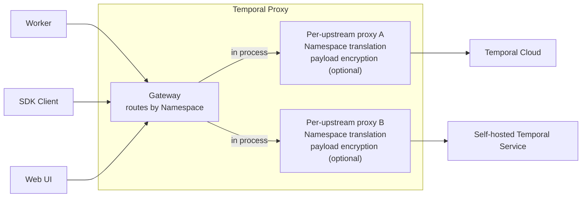

import { ReleaseNoteHeader } from '@site/src/components';

<ReleaseNoteHeader type="publicPreview">
  Temporal Proxy is under active development and evolving quickly. Behavior and configuration can change between
  releases. See the [temporal-proxy repository](https://github.com/temporalio/temporal-proxy) for the current status and
  the definitive configuration schema.
</ReleaseNoteHeader>

The Temporal Proxy is a gRPC proxy that sits between your Temporal SDK Clients, Workers, and the Temporal Web UI on one
side and one or more upstream Temporal Services on the other. It handles Namespace translation, TLS termination, and
optional payload encryption so your applications can target a single local endpoint while the proxy routes each request
to the right upstream, whether that is a local development Service, a self-hosted Service, or Temporal Cloud.

## Why use it

Without the proxy, connection details leak into your application code. Every Worker and Client has to know the
upstream's host, TLS material, credentials, and the exact Namespace name the upstream expects. That couples your code to
an environment: moving between a local Service, a self-hosted deployment, and Temporal Cloud becomes a code change.

The proxy owns that concern instead. Workers talk plaintext to a single local endpoint using a short Namespace name, and
the proxy adds TLS, credentials, and Namespace translation on the way out. Point a Worker at a different Namespace and
it reaches a different upstream, with no change to the Worker.

## How it works

The proxy is built from a gateway and one proxy per upstream, running in a single process:

- The **gateway** is the single inbound endpoint that every Worker, SDK Client, and the Web UI connects to.
- Each **upstream** has its own proxy that handles communication with that destination.



For each request, the gateway:

1. refuses the call if its gRPC service is not one the configuration allows, before any upstream work. By default that
   allows `WorkflowService` and `OperatorService` and nothing else.
2. reads the target Namespace from the request.
3. picks an upstream: the first matching routing rule, otherwise the system upstream for Namespace-less calls, otherwise
   the default.
4. hands the request to that upstream's proxy, in the same process.

The per-upstream proxy then rewrites the local Namespace to the name the upstream expects, attaches that upstream's TLS
and credentials, forwards to the Temporal Service, and translates the Namespace back on responses. When payload
encryption is enabled, it also seals codec-capable Payloads on the way out and opens them on the way back. New Payloads
sent through the proxy reach the upstream as ciphertext. See
[Encrypt payloads](/production-deployment/temporal-proxy/encrypt-payloads) for the scope and limits of this fail-closed
behavior.

The proxy reads only the Namespace and the fields it translates, so it needs no knowledge of your Data Converter or
codec, and payload data passes through untouched unless encryption is configured. The gateway accepts gzip-compressed
requests, so a Client with gRPC compression turned on works through it.

:::note Version note

Before v0.9.0, the gateway and each per-upstream proxy were connected by unix sockets. v0.9.0 serves every upstream in
the gateway's process. Nothing in the configuration changes, but per-upstream sockets no longer exist to dial directly.

:::

### Terms

| Term             | Meaning                                                                                                                                                                                         |
| ---------------- | ----------------------------------------------------------------------------------------------------------------------------------------------------------------------------------------------- |
| gateway          | The single inbound gRPC endpoint that every SDK Client, Worker, and the Web UI connects to. It routes each request to an upstream by Namespace and request metadata.                           |
| upstream         | A configured destination the proxy forwards to: a Temporal Service (local dev, self-hosted, or Temporal Cloud), or another Temporal Proxy.                                                      |
| system upstream  | The upstream that handles Namespace-less requests, such as the SDK's `GetSystemInfo` call on connect.                                                                                           |
| extension server | A gRPC service you run that the proxy calls out to for a capability it has no built-in backend for: wrapping data encryption keys, or deciding whether an inbound call may proceed.             |
| Temporal Service | A Temporal frontend the proxy connects to.                                                                                                                                                      |

## Prerequisites

- One or more upstream Temporal Services to route to, such as a local development Service, a self-hosted Service, or
  Temporal Cloud.
- The `hostPort` address for each upstream.
- Any credentials the upstreams require, such as a Temporal Cloud API key or mTLS certificates.
- Go installed, if you build the proxy from source. The container image and Helm chart do not require a local Go
  toolchain.

## Install the proxy

**Recommended starting size:** For a Temporal Proxy instance that applies payload encryption for all payload sizes,
use **4 CPUs and 12 GiB of memory**, with `GOMEMLIMIT=11GiB`, and plan for each instance to handle up to
**3,000 requests per second and 100 SDK Workers**. Scale beyond these limits by adding more Proxy replicas (instances)
behind a gRPC-compatible load balancer. For more efficient sizing based on the features and payload sizes you use, see
[Sizing and performance](/production-deployment/temporal-proxy/sizing-and-performance).

Install the `proxy` binary with Go:

```bash
go install github.com/temporalio/temporal-proxy/cmd/proxy@latest
```

Pin an explicit version instead of `@latest`, using a tag from the
[releases page](https://github.com/temporalio/temporal-proxy/releases):

```bash
go install github.com/temporalio/temporal-proxy/cmd/proxy@vX.Y.Z
```

Pull the container image:

```bash
docker pull temporalio/temporal-proxy:latest
```

Install with Helm from the Temporal Helm repo, optionally pinning a chart version with `--version`:

```bash
helm install temporal-proxy temporal-proxy \
  --repo https://go.temporal.io/helm-charts
```

Each chart release deploys a proxy version by default. Override it with `--set image.tag=vX.Y.Z`. Supply the proxy
configuration under the `config` key of a Helm values file, as described in
[Deploy to Kubernetes](/production-deployment/temporal-proxy/deploy-kubernetes).

Run the proxy with a configuration file passed through the `-c` (or `--config`) flag:

```bash
proxy serve -c config.yaml
```

`--config` also reads the `PROXY_CONFIG` environment variable, which is how the Helm chart points the proxy at its
mounted configuration. See [Observability](#observability) for the log level flag and the metrics settings.

:::caution Upgrade to v0.9.0

Two v0.9.0 changes stop an older configuration from starting:

- A configuration with encryption keys must set `encryption.namespaceBinding`. Set `off` before you upgrade a
  deployment that already holds encrypted payloads, then follow
  [Bind payloads to their Namespace](/production-deployment/temporal-proxy/encrypt-payloads#namespace-binding) to move
  to `strict`.
- The v0.8.0 top-level `codecServer` block moved to `http.codecServer`. See
  [Run a codec server](/production-deployment/temporal-proxy/codec-server).

:::

## Observability {/* #observability */}

The proxy serves Prometheus metrics at `/metrics` on `:9090` by default and logs JSON to stderr. The gateway also serves
the standard gRPC health service, with an entry for every allowed service, which is what a Client health check or a
liveness probe reads. See [Report health](/production-deployment/temporal-proxy/configure#health-checks) for what it
reports.

`proxy serve` takes two flags, each with an environment variable equivalent:

| Flag             | Environment variable | Default | Sets                                         |
| ---------------- | -------------------- | ------- | -------------------------------------------- |
| `--config`, `-c` | `PROXY_CONFIG`       | none    | Path to the configuration file. Required.    |
| `--level`        | `LOG_LEVEL`          | `info`  | Log level: `debug`, `info`, `warn`, `error`. |

Everything else about metrics comes from the `metrics` block in the configuration file:

```yaml
metrics:
  hostPort: :9090 # Address serving /metrics.
  namespace: tmprl_proxy # Prometheus namespace prefixed onto every metric.
  labels:
    namespace: false # Report the Temporal Namespace on metrics that can name one.
    fixed: # Constant labels stamped on every series.
      region: us-east-1
    metadata: # Inbound headers reported as labels, written <header>:<name>.
      - x-tenant:tenant
```

:::note Version note

`metrics.hostPort` and `metrics.namespace` replace the `--metrics-addr` and `--metrics-namespace` flags, removed in
v0.6.0 along with their `METRICS_ADDR` and `METRICS_NAMESPACE` environment variables. The defaults are the same, so a
deployment that never set them needs no change.

:::

- `labels.namespace` decides whether the metrics that can name a Temporal Namespace report it. It is `false` by default. The value comes from the request, so every Namespace a Client names adds another series. The label is declared either
  way and only its value is dropped, so a query that already ignores it reads the same before and after you turn enable it.
  The name reported is the local, pre-translation one, the same key you write under `encryption.overrides`.
- `labels.fixed` maps a label name to a constant value stamped on every series the proxy publishes, such as the region
  or cluster a deployment runs in.
- `labels.metadata` reports an inbound request header as a label on the request-scoped series, written
  `<header>:<name>`. Values are truncated at 256 bytes. An encryption operation that came from the
  [codec server](/production-deployment/temporal-proxy/codec-server) reports these labels blank, because an HTTP request
  carries no gRPC metadata.

:::caution

Do not list a header that carries a credential, such as an API key or bearer token, under `labels.metadata`. The
`/metrics` endpoint doesn't require authentication, so anyone who can reach the port can read the header's value.

Also avoid headers whose values the caller can set freely. Each distinct value creates a new copy of every
request-scoped series, so an unbounded header causes unbounded metric cardinality.

:::

Metric names are `<namespace>_<subsystem>_<name>`, so with the default namespace the routing counter is
`tmprl_proxy_router_decisions_total`. There are four subsystems:

| Subsystem      | Metric                             | Labels                               | Reports                                                  |
| -------------- | ---------------------------------- | ------------------------------------ | -------------------------------------------------------- |
| `server`       | `requests_total`                   | `method`, `code`                     | RPCs served, by gRPC status code                         |
| `server`       | `request_duration_seconds`         | `method`                             | End-to-end time serving an RPC                           |
| `server`       | `panics_total`                     | `method`                             | Panics the server recovered from while serving an RPC    |
| `router`       | `decisions_total`                  | `upstream`, `outcome`                | Routing decisions, by chosen upstream                    |
| `router`       | `forwarding_errors_total`          | `upstream`, `reason`                 | Forwarding failures the router originated                |
| `encryption`   | `vault_ops_total`                  | `operation`, `result`, `namespace`   | Envelope operations, sealing and opening payloads        |
| `encryption`   | `vault_ops_duration_seconds`       | `operation`, `namespace`             | Time per envelope operation, end to end                  |
| `encryption`   | `payloads_skipped_total`           | `operation`, `encoding`, `namespace` | Payloads passed through under `skipEncodings`            |
| `encryption`   | `vault_unbound_opens_total`        | `namespace`                          | Payloads with no Namespace binding handed to decrypt     |
| `encryption`   | `vault_namespace_mismatches_total` | `namespace`                          | Payloads bound to another Namespace handed to decrypt    |
| `encryption`   | `dek_ops_total`                    | `operation`, `result`                | Outcome of the AES-256-GCM step alone                    |
| `encryption`   | `dek_ops_duration_seconds`         | `operation`                          | Time in the AES-256-GCM step alone                       |
| `encryption`   | `kek_ops_total`                    | `provider`, `operation`, `result`    | DEK wrap and unwrap calls to your KMS                    |
| `encryption`   | `kek_ops_duration_seconds`         | `provider`, `operation`              | Time spent wrapping and unwrapping DEKs                  |
| `encryption`   | `dek_rotations_total`              | `reason`                             | DEK rotations, by why the DEK was replaced               |
| `encryption`   | `dek_cache_hits_total`             | none                                 | Reads served from the decrypted-DEK cache                |
| `encryption`   | `dek_cache_misses_total`           | none                                 | Reads that required a KMS unwrap                         |
| `encryption`   | `dek_cache_size`                   | none                                 | Current entries in the decrypted-DEK cache               |
| `codec_server` | `requests_total`                   | `route`, `code`                      | Codec server requests, by HTTP status code               |
| `codec_server` | `request_duration_seconds`         | `route`                              | Time serving a codec server request                      |

:::note Version note

v0.6.0 renamed the three `*_duration_secs` histograms to `*_duration_seconds` to follow the Prometheus convention.
Update any dashboard or alert that names the old spelling.

:::

The `namespace` label reports a value only when `metrics.labels.namespace` is on. It is declared either way, so the
series exist regardless.

The `encryption` metrics only move when [payload encryption](/production-deployment/temporal-proxy/encrypt-payloads) is
configured. They are layered, so pick the one that matches the question you are asking:

- `vault_ops_*` is the whole envelope operation end to end, including any KEK call and cache lookup, and is the pair to
  alert on.
- `dek_ops_*` is the symmetric AES-256-GCM step by itself, with the KEK work excluded. Its `result` is that step's own
  outcome, so a payload that encrypts cleanly and then fails to wrap its DEK counts as a success here and an error under
  `kek_ops_total`, which keeps the blame with the KMS.
- `kek_ops_*` is the calls to your KMS. Watch `kek_ops_total{result="error"}`, since a failure to wrap or unwrap a DEK
  fails the request that needed it.

Besides `success` and `error`, `vault_ops_total` reports three refusals by `result`:

- `unknown_key`: the payload was sealed under a KMS key this proxy doesn't hold.
- `unbound`: `strict` [Namespace binding](/production-deployment/temporal-proxy/encrypt-payloads#namespace-binding)
  refused a payload that carries no binding.
- `mismatch`: `strict` binding refused a payload bound to another Namespace.

The `codec_server` metrics only move when the [codec server](/production-deployment/temporal-proxy/codec-server) is
enabled. Their `route` label is the matched pattern, such as `/decode`, never the request path, and the subsystem has
no Namespace label, so a Namespace in the path cannot grow the series count.

`dek_rotations_total` splits by `reason`: `initial` for a Namespace's first DEK, `scheduled` for the `renewBefore`
pre-rotation, and `on_demand` for a DEK replaced at request time because no fresh one was ready. A rising `on_demand`
rate means rotation is falling behind, so raise `renewBefore`. Compare the cache counters against `cacheSize` to see
whether the cache is absorbing read traffic.

## Versions and support

The following support policy applies to Temporal Proxy v1.0 and later. Support for Temporal customers includes
troubleshooting through Temporal Support and maintenance releases with critical fixes for security, data loss, and
reliability issues.

Temporal supports the current minor release and at least the three preceding minor releases, when available. Versions
earlier than v1.0 are excluded from this support window. For example, when v1.4 is current, the supported minor releases
include v1.1, v1.2, v1.3, and v1.4; when v1.1 is current, they include v1.0 and v1.1.

Each major version receives support for at least 12 months after its general availability release. Temporal provides at
least six months' notice before ending support for a major version.

Temporal Support may require you to upgrade to the latest bugfix (patch) release within your supported minor version
before proceeding with support if that patch introduces critical functionality related to your reported issue.

Temporal publishes CVE advisories when a fix is available. Report vulnerabilities privately to
[security@temporal.io](mailto:security@temporal.io), following the
[Temporal Proxy security policy](https://github.com/temporalio/temporal-proxy/blob/main/SECURITY.md).

## Related

- [Sizing and performance](/production-deployment/temporal-proxy/sizing-and-performance)
- [Run a codec server](/production-deployment/temporal-proxy/codec-server)
- [Temporal Proxy repository](https://github.com/temporalio/temporal-proxy)
- [Temporal Proxy Helm chart](https://github.com/temporalio/helm-charts/tree/main/charts/temporal-proxy)
- [Temporal Cloud example](https://github.com/temporalio/temporal-proxy/tree/main/examples/cloud)
- [KMS extension server example](https://github.com/temporalio/temporal-proxy/tree/main/examples/kms)
- [Codecs and Encryption](/production-deployment/data-encryption)
- [Self-hosted guide: Security](/self-hosted-guide/security)
