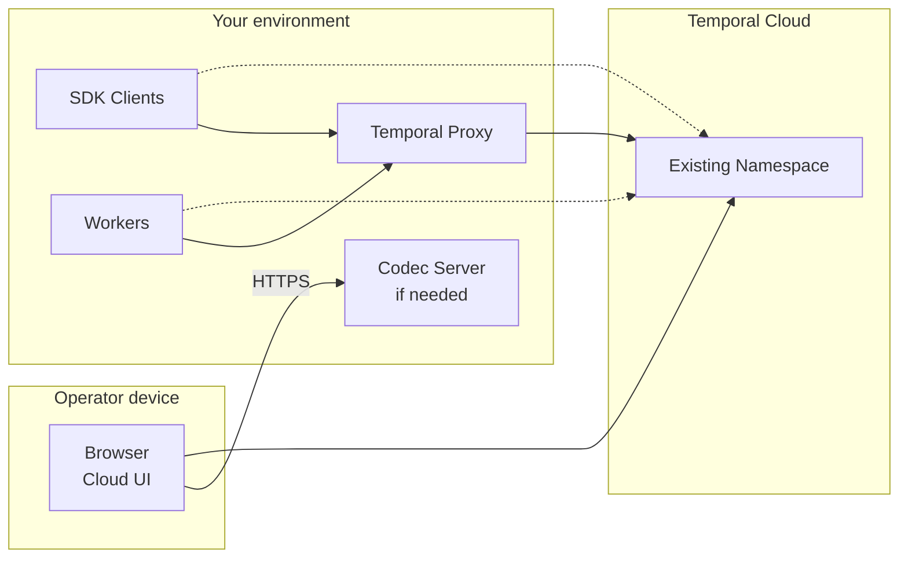

import { ReleaseNoteHeader } from '@site/src/components';

<ReleaseNoteHeader type="prerelease">
  Temporal Proxy is under active development and evolving quickly. Behavior and configuration can change between
  releases. Pin a version and check its [configuration schema](https://github.com/temporalio/temporal-proxy) before
  starting this rollout. The Codec Server and `skipEncodings` examples below require a version that supports those
  features.
</ReleaseNoteHeader>

We recommend a rollout with two stages:

1. Move your Clients and Workers onto the proxy without changing how they encode payloads.
2. Enable proxy encryption if you want the proxy to manage it.

Keep the same Temporal Cloud Namespace, Task Queues, and Workflow IDs through both stages. Existing Workflow
Executions continue in that Namespace; this rollout does not copy or restart them.

This guide assumes you already have Clients and Workers connected to Temporal Cloud. Use
[Configure the proxy](/production-deployment/temporal-proxy/configure) for configuration details and
[Deploy to Kubernetes](/production-deployment/temporal-proxy/deploy-kubernetes) for Helm installation and secrets.

## Identify your current encryption setup

Check the Data Converter configuration in every Client and Worker, rather than inferring it from whether you have a
Codec Server. A [Payload Codec](/payload-codec) normally encrypts data inside your SDK applications. A
[Codec Server](/codec-server) exposes that codec over HTTP so the Web UI and CLI can encode inputs and decode stored
payloads. It is a separate connection from the gRPC connection to Temporal Cloud.

If your applications call a remote codec, include that service in the inventory too. Adding Proxy does not automatically
replace those calls or import the service's codec logic and keys.

| Current setup | First stage: connect through Proxy | Second stage: enable Proxy encryption (optional) |
| --- | --- | --- |
| No payload encryption and no Codec Server | Change connections; keep your existing Data Converters. | Prepare all readers for proxy-encrypted data and provide a Codec Server for the Cloud UI and direct CLI access. |
| Existing payload encryption with a Codec Server | Keep your existing encryption, keys, and Codec Server endpoint. | Keep or extend the existing server to decode legacy and proxy formats before changing how new payloads are encrypted. |

:::note SDK encryption without a Codec Server

SDKs can encrypt payloads directly without a Codec Server, but this is an uncommon setup. These Clients and Workers can
still route through Proxy while keeping their local encryption. After Proxy encryption is enabled and validated, you
can optionally stop local encryption of new payloads. First ensure your application decoders accept both legacy
ciphertext and the payloads Proxy returns after decryption. Keep the legacy decoding logic and keys for existing
history. Without a Codec Server, the Cloud UI cannot decode those encrypted payloads.

:::

Record the Cloud endpoint and full Namespace name, authentication method, Task Queues, payload encoding metadata, and
keys used by retained history. Include Schedule actions, asynchronous Activity completion processes, administrative
scripts, and other payload producers or consumers alongside your application Clients and Workers.

Decide whether to stop after the first stage or continue to the optional second stage. Keeping your existing encryption
and Codec Server while leaving proxy encryption disabled is a valid final state.

## Plan the network paths

Deploy the proxy in infrastructure you control. A sidecar or local process gives each application a loopback endpoint;
a shared deployment gives applications a network endpoint. For a shared endpoint, configure gateway TLS and inbound
authentication or authorization before moving traffic. The proxy's Cloud credentials do not authorize callers to use
the gateway. See [Configure TLS](/production-deployment/temporal-proxy/configure#configure-tls) and
[Authenticate and authorize inbound requests](/production-deployment/temporal-proxy/configure#authenticate-and-authorize-inbound-requests).

The diagram shows the connection change. Dashed paths are the original direct connections; solid paths are the target
connections. The Cloud UI continues to connect to Temporal Cloud, and your browser calls a Codec Server separately
when decoding is needed.



With proxy encryption, the proxy sees application payloads in plaintext unless your existing Payload Codec has
encrypted them. Keep it inside your trust boundary. Protect the application-to-proxy connection separately from the
proxy-to-Cloud TLS connection.

Provide enough proxy capacity and redundancy for Worker long polls and Client requests. In a shared deployment, losing
the proxy interrupts every application using that endpoint. If you run proxies in multiple regions, prepare the Cloud
connectivity and KMS access in each region and test decryption across regions before enabling encryption.

## Deploy Proxy without changing payload encoding

For the first stage, deploy Proxy with encryption disabled. Preserve the full Cloud Namespace name in applications
and omit Namespace translation for this stage. This avoids changing both connection settings and Namespace names at
once.

For a local proxy, save the following as `config.yaml`. Set `TEMPORAL_CLOUD_ADDRESS` to your existing Cloud endpoint,
including port `7233`, and supply `TEMPORAL_API_KEY` through your secret management system. The API key must have access
to the existing Namespace.

```yaml
hostPort: 127.0.0.1:7233

routing:
  default: cloud
  system: cloud

upstreams:
  - name: cloud
    hostPort: ${TEMPORAL_CLOUD_ADDRESS}
    credentials:
      static:
        apiKey: ${TEMPORAL_API_KEY}

encryption:
  enabled: false
```

The proxy dials Cloud over TLS by default in v0.6.0 and later. The `system` route sends Namespace-less requests, such as
the SDK's connection-time `GetSystemInfo` call, to the same fixed endpoint. If you currently use mTLS, configure the
upstream's certificate, key, and CA instead of the API key as described in
[Configure TLS](/production-deployment/temporal-proxy/configure#configure-tls).

Start the proxy with this configuration:

```command
proxy serve --config config.yaml
```

The `--config` flag selects the YAML file. This example serves plaintext only on loopback. For a shared deployment,
use the secured gateway address and configure applications to trust its certificate and present its required
credentials.

## Move Clients and Workers in batches

Continue the first stage by moving a test Client and Worker onto the proxy, then expand one deployment at a time:

1. Change the SDK connection address to the proxy endpoint. For the loopback example, use `127.0.0.1:7233`, disable
   Cloud-specific TLS on that local connection, and remove the Cloud API key or Cloud client certificate from that
   connection. For a secured shared gateway, use its TLS and authentication settings instead.
2. Keep the full Cloud Namespace name, Task Queue names, Workflow code, and Data Converter configuration unchanged.
3. Verify a new Workflow can start, execute an Activity, and return a result. Also verify an existing Workflow can
   resume after a Worker restart and receive a Signal or Update used by your application.
4. Roll out the connection change to the remaining Clients and Workers. Shut down Workers gracefully using your SDK's
   shutdown mechanism and verify replacement Workers poll the intended Task Queues.

While encryption is disabled, direct and proxied applications can share the Namespace because Proxy does not change
payload encoding. An existing Codec Server continues to work with the same payloads and endpoint.

Compare request errors, latency, Worker polling, and Task Queue backlog with your baseline. Proxy health alone does not
prove that Cloud authentication, routing, or payload decoding works; exercise an application request. Keep enough
Worker capacity available throughout the rollout. See
[Shut down cleanly](/production-deployment/temporal-proxy/deploy-kubernetes#shut-down-cleanly) for proxy restarts.

This completes the first stage. Stop here if you want to keep your current encryption setup. To continue to the
optional second stage, complete the reader and Codec Server preparation below before any proxy begins encrypting new
payloads.

## Prepare every reader for proxy encryption

Begin the optional second stage by configuring the same KMS key policies and decrypt permissions on every proxy that
serves the Namespace, initially with `enabled: false`. Add this fragment to the existing configuration after
provisioning your key and granting the proxy identity access. Replace the example AWS key ARN with your own; other
providers are described in
[Encrypt payloads](/production-deployment/temporal-proxy/encrypt-payloads).

```yaml
encryption:
  enabled: false
  default:
    uri: awskms:///arn:aws:kms:us-east-1:123456789012:key/abcd-1234?region=us-east-1
    duration: 1h
    renewBefore: 15m
```

Restart each proxy to load the policy. With keys configured, a decrypt-only proxy can open proxy-encrypted responses
even though it does not encrypt new outbound payloads. Test that each replica can decode data written by an
encryption-enabled proxy in a test Namespace before enabling encryption in your existing Namespace.

Move every application that consumes payloads behind a compatible proxy, or give it a compatible decoder. A direct
Worker cannot execute tasks containing proxy-encrypted inputs with the default Data Converter. A direct Client cannot
read encrypted results with it either. Moving only Workflow starters is insufficient: Activity Workers, message
senders, and asynchronous Activity completion processes must participate too.

For deployments with an existing Codec Server, keep the legacy payload decoder and its keys in both your applications
and the Codec Server. Proxy does not decode arbitrary custom codec formats. Configure `encryption.skipEncodings` to
avoid wrapping payloads already encrypted by your existing codec while Proxy encrypts other payloads:

```yaml
encryption:
  enabled: false
  skipEncodings:
    - binary/your-existing-encryption
  default:
    uri: awskms:///arn:aws:kms:us-east-1:123456789012:key/abcd-1234?region=us-east-1
    duration: 1h
    renewBefore: 15m
```

Replace the encoding with the actual value your codec writes to `metadata.encoding`. This is a trust decision: Proxy
does not verify that a payload carrying a skipped encoding is encrypted. If you list `binary/encrypted`, Proxy also
passes through encrypted responses that reference keys it does not know, so monitor unknown-key results. Check your
version's [skip behavior](https://github.com/temporalio/temporal-proxy/blob/main/pkg/codec/encryptor.go) before using it.

To move encryption entirely to Proxy, first update application decoders to accept both legacy ciphertext and the
serialized payloads Proxy returns after decryption. Update your Codec Server to decode both legacy and proxy-encrypted
data. Then enable proxy encryption, and only afterward stop encrypting new data with your previous codec. Preserve its
decode logic and any compression, custom serialization, or Failure Converter behavior still needed by existing history.
Test both formats across every SDK you use; sharing an encoding name or a KMS key does not prove compatibility.

Without `skipEncodings`, Proxy adds an outer encryption layer to payloads encrypted by your existing codec. Proxy
removes its layer on responses, and your application decoder removes the remaining layer. Any direct reader's Codec
Server must reverse both layers in that order. Avoid introducing this extra layer unless you have tested the complete
decode path.

## Preserve Cloud UI and CLI access

As part of the second stage, prepare the HTTP decode path before enabling encryption. The hosted Cloud UI does not
use your proxy's gRPC gateway. Your browser retrieves encrypted history from Cloud and sends payloads to the configured
Codec Server for decoding.

If you have no existing Codec Server, you can use Proxy's built-in Codec Server for proxy-encrypted payloads. It serves
HTTP on a separate listener from the gRPC gateway. The following fragment uses the current `http.codecServer` schema;
older versions may use different settings. Add it to the proxy configuration with your key policy, supply the TLS
files, and restart the proxy:

```yaml
http:
  hostPort: :8443
  tls:
    cert: /etc/temporal-proxy/certs/codec/tls.crt
    key: /etc/temporal-proxy/certs/codec/tls.key
  codecServer:
    enabled: true
    cors:
      origins:
        - https://cloud.temporal.io
      credentials: true
    auth:
      jwks:
        url: https://login.tmprl.cloud/.well-known/jwks.json
```

This fragment authenticates Cloud UI tokens. Configure your Namespace's Codec Server endpoint in the Cloud UI to the
HTTPS base URL that reaches this listener, and enable **Pass access token**. The operator's browser must be able to
reach that URL and trust its TLS certificate. Authentication alone does not restrict decoding per Namespace; add
authorization appropriate to your users and keys. See the
[Proxy Codec Server reference](https://github.com/temporalio/temporal-proxy#codec-server) for supported authentication
and authorization settings.

If you have an existing Codec Server, keep it available for legacy payloads. Extend it with a tested decoder for
Proxy's format, or expose a combined handler that applies the proxy decoder before the legacy decoder when both layers
are present. Proxy's built-in server does not automatically run your existing custom codec. Test histories containing
plaintext, legacy ciphertext, proxy ciphertext, and both layers if you use them. If you use
[External Storage](/codec-server#external-storage), preserve its retrieval and decoding order too.

For the CLI, choose and test one of these paths:

- Connect through the gRPC proxy and let it decode its encryption layer. An additional legacy layer still needs a
  compatible Codec Server or decoder.
- Connect directly to Cloud with Cloud credentials and set `--codec-endpoint` to an HTTP endpoint that decodes every
  format present in the history. Supply the Codec Server credentials required by your chosen authentication method.

Also test **encoding** when operators start Workflows or send Signals directly from the Cloud UI or CLI. Inputs must
use a format your Workers accept. The proxy cannot encrypt requests that bypass its gateway, so direct writes require
a compatible `/encode` endpoint if you require payload encryption. During the migration, keep its output compatible
with any remaining legacy decoders.

## Enable encryption and validate the transition

Complete the optional second stage by enabling encryption in a test Namespace first. For the existing Namespace,
proceed only after every proxy can decrypt the configured keys, every application reader is compatible, and operators
can decode both old and new history.

Set `encryption.enabled: true` and restart proxies in batches. Keep the key policy and any tested `skipEncodings`
settings. During this restart, decrypt-only replicas can read the enabled replicas' output, but still write payloads
without proxy encryption. If every new write must be encrypted from a specific point onward, pause unencrypted
producers until all replicas are enabled or preserve your existing encryption during the transition.

Validate these behaviors before advancing each batch:

- An existing Workflow replays from history after a Worker restart and handles new work.
- New Workflow and Activity inputs and results, Signals, Updates, Queries, and heartbeat details used by your
  application round-trip through the proxy.
- The Cloud UI and CLI display old and new payloads, and their direct writes use the expected encoding.
- Raw history fetched directly from Cloud contains proxy encryption metadata on newly encrypted payloads. Inspect a
  test payload without a Codec Server so your check does not decode the evidence.
- Replacing a proxy replica and testing a KMS failure in a test environment produces the expected retries and errors.
  Proxy must fail encryption-dependent requests rather than send those payloads as plaintext.

Watch [Proxy metrics](/production-deployment/temporal-proxy#observability), application errors, and Task Queue backlog.
Investigate failed KMS operations, unexpected skipped payloads, or `unknown_key` results before continuing. Encryption
adds payload size overhead, so include representative large payloads in validation.

Enabling encryption affects new writes through Proxy. It does not rewrite old Event History or encrypt Search
Attributes and identifiers. Failure messages and stack traces require separate failure encoding; on versions that
support it, `encryption.failures: true` includes those attributes. See
[Encryption coverage](/production-deployment/data-encryption) for the boundaries.

After validation, remove unused application Cloud credentials and restrict direct application access if all application
traffic must pass through Proxy. Account for authorized Cloud UI and CLI paths separately; their Codec Server remains
part of the encryption design.

## Roll back without losing access to history {/* #roll-back */}

Before you write any proxy-encrypted data in the second stage, you can restore the previous direct Cloud connections
and Cloud credentials while keeping your existing encryption and Codec Server.

After you write proxy-encrypted data in the second stage, keep a compatible decryption path. Restore the previous
application release against the proxy, or set `encryption.enabled: false` to stop new proxy encryption while keeping
key policies and KMS decrypt access. If `encryption.failures` is enabled, turn it off too. Restart the proxies and verify both old and new
history remain readable. Disabling encryption does not decrypt stored history.

Do not reconnect applications directly to Cloud unless they can decode every stored format. If you disabled your
previous encryption during adoption, restore it before disabling proxy encryption when new payloads must remain
encrypted.

Keep legacy codecs, Codec Server support, and keys for as long as retained data needs them. Include open Workflow
Executions, Schedule payloads, retained closed histories, exports, and any archived data you still need to read;
waiting one retention period after the connection change is not sufficient for long-running Workflows. Retire a
decoder only after verifying no required data uses its format. See
[Key policies](/production-deployment/temporal-proxy/encrypt-payloads) for retaining old keys with `decryptURIs`.
